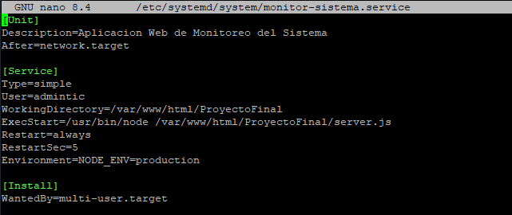
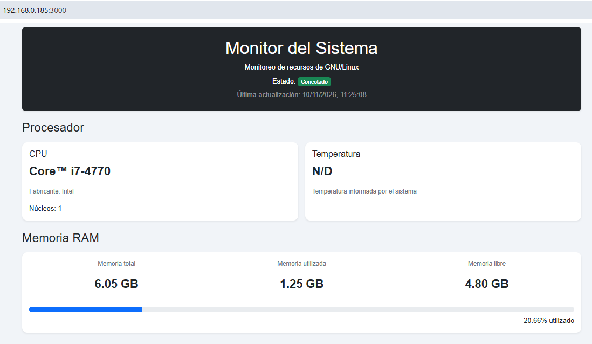
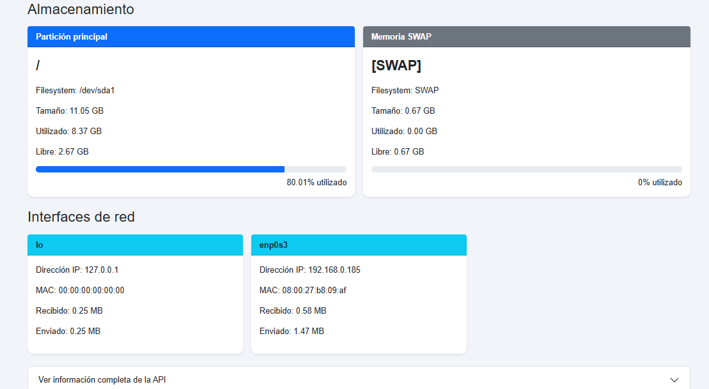
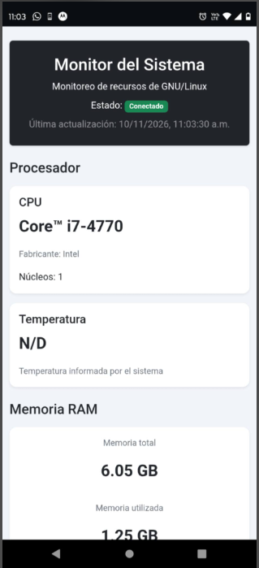

# Tp Final Integrador
Este proyecto se basa en desarrollar una aplicacion servidor para monitorear la información de los recursos de hardware de un servidor GNU/Linux, la exponga mediante
una API y permita visualizarla desde una aplicación frontend web y móvil.

# Tecnologias utilizadas 

Frontend: css, js, html, boostrap5 

backend: node, js, pnpm, socket.io, Express, CORS, systeminformation 

# Funcionalidades
Esta aplicacion permite revisar en tiempo real distintos datos relacionados al hardware del servidor donde se encuentra activa 

Tales como:

-Cpu: Fabricante, modelo, nucleos, temperatura

-Memoria ram: Total, libre, usada

-Disco Duro: Particiones, total, usado, disponible, porsentajes y graficas 

-Red: nombre de la interfaz, ip, mac

# Estructura del proyecto 
ProyectoFinal/

│

├── public/

│   ├── index.html

│   ├── estilos.css

│   └── app.js

│

├── publicParaAppmovil/

│   ├── index.html

│   ├── estilos.css

│   └── app.js

├── server.js

│

├── package.json

├── pnpm-lock.yaml

├── .gitignore

├── README.md

# Requisitos
node.js

npm

pnpm

# Instalacion

### 1. Descargar el proyecto de github

### 2. Crear carpetas del proyecto y moverlo a su nueva ubicacion mv /Descargas/ProyectoFinal /var/www/html/

### 3. Acceder a su direcctorio del proyecto con cd /var/www/html/ProyectoFinal 

### 4. Instalar las dependecias utilizando: pnpm install

### 5. Usar el comando pnpm star para levantar la pagina

### 6. Para que inicie solo como un servicio hay que ingresar por consola nano /etc/systemd/system/monitor-sistema.service y pegar lo siguiente dentro:

### 7. Usar los siguientes comandos: systemctl daemon-reload, systemctl enable --now monitor-sistema, systemctl status monitor-sistema para que inicie automanticamente cada vez que el servidor este activo

### 8. Instalar el apk de la carpeta "AplicacionMovil" en un dispositivo móvil para poder monitorear desde ahí los datos servidor

# Funcionamiento
Una vez instalada la aplicacion, solo se tiene que ingresar a travez de un navegador a https //localhost:3000/ o desde otra pc en la misma red https //Ip-del-servidor:3000/ ej:https //192.168.0.185:3000/
Para el caso de la app movil se configuro para la ip del servidor debian https //192.168.0.185:3000/
En la Carpeta AplicacionMovil se encuentra el apk para instalarlo en dispositivos móviles 
En la carpeta publicParaAppmovil se encuentra el frontend que se utilizo para ser empaquetado usando HTML2APK, se configuro el mismo para que levante solo la ip del servidor linux (192.168.0.185), en cambio el de public levanta //localhost:3000/

# Capturas de pantalla

## Inicio

## App movil

# Documentacion de commits

* c74de22 001 Proyecto Base

* 02af6e2 002 Creacion del frontend y mejoras del servidor

* a035c02 (Adaptacion-a-windows) Cambios a server.js para correr en windows

* 9c71232 (HEAD -> master) 004 Cambios esteticos

* 4e35d66 (HEAD -> master) 005 Incorporacion de publicParaAppmovil para HTML2APK

Captura del merge

# Autor
Luis Eduardo Valls
